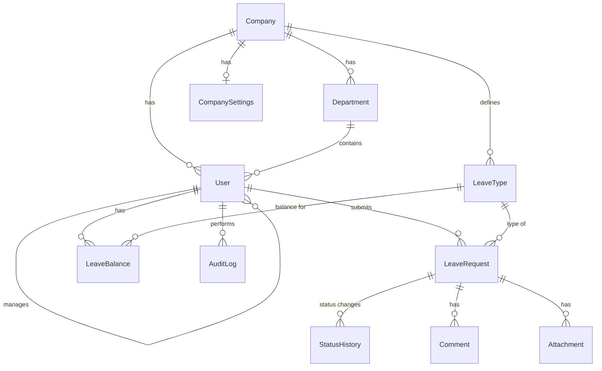

# StaffAway Backend

[](https://github.com/aleksa0206/StaffAway-Backend/actions/workflows/ci.yml)

API for StaffAway, a leave management app for companies. Employees request time off, managers and HR approve it, and everyone sees who is away. Each company is a separate tenant in the same database.

Live: [staffaway.space](https://staffaway.space) | Frontend: [StaffAway-Frontend](https://github.com/aleksa0206/StaffAway-Frontend)

## What it does

- Sign-up creates a company with its first Hr user, default settings and two leave types. Login works after the email is confirmed
- Leave requests with an approval flow (`Pending`, `Approval`, `Rejected`, `Cancelled`). Overlapping requests are rejected, minimum notice is checked and balances update automatically
- Nobody approves their own request, managers only decide for their direct reports
- Status history, comments, attachments (S3), notifications, audit log
- Company admin: departments, leave types, holidays, work schedules, settings, API keys
- Roles `Employee`, `Manager`, `Hr`, checked per endpoint and per record

## Database

Main tables (full schema in `prisma/schema.prisma`). Almost every table has `companyId`, that's how tenants are separated.



## Stack

Node.js 24, TypeScript, Express 5, Prisma 7, MySQL 8, Zod, Pino, Jest + Supertest, AWS S3, Nodemailer, Docker.

Code is split into routes, controllers, services and repositories. Auth is JWT + refresh token in an httpOnly cookie, optional TOTP 2FA and account lockout after 5 failed logins. Rate limiting is stored in the database so it works with more than one instance.

## Getting started

Requirements: Node.js 24, Docker (for MySQL).

```bash
npm install
docker-compose up -d            # MySQL on localhost:3306
cp .env.example .env            # then fill in the values (see below)
npx prisma migrate deploy
npx prisma generate
npm run seed:demo               # optional demo company
npm run dev                     # http://localhost:4000
```

`npm run seed:demo` creates a demo company and prints an HR, manager and employee login. Password for all of them is `Password123`.

## Environment variables

| Variable | Required | Notes |
| --- | --- | --- |
| `PORT` | no | Default `4000` |
| `NODE_ENV` | no | `development` / `test` / `production` |
| `DB_HOST`, `DB_PORT`, `DB_USER`, `DB_PASSWORD`, `DB_NAME` | yes | Used by the app at runtime. On Windows use `127.0.0.1`, not `localhost` |
| `DATABASE_URL` | yes | Used only by the Prisma CLI (migrations) |
| `JWT_SECRET` | yes | At least 32 characters |
| `S3_REGION`, `S3_BUCKET`, `S3_ACCESS_KEY_ID`, `S3_SECRET_ACCESS_KEY` | yes | Attachment storage |
| `FRONTEND_URL` | in production | CORS origin and password-reset links. Default `http://localhost:5173` |
| `SMTP_HOST`, `SMTP_PORT`, `SMTP_USER`, `SMTP_PASS` | in production | Verification and password-reset emails |
| `SMTP_FROM` | no | Sender shown to recipients, e.g. `StaffAway <noreply@example.com>`. Defaults to `SMTP_USER` |
| `TRUST_PROXY` | no | number of proxies in front of the app, leave `0` if there are none |
| `METRICS_TOKEN` | no | enables `GET /metrics` (bearer token, min 16 characters) |

## Tests

Integration tests run against a real MySQL test database from `.env.test`. S3 is replaced with an in-memory fake.

```bash
npm run test:migrate
npm test
```

## Docker

```bash
docker build -t staffaway-backend .
docker run --env-file .env -p 4000:4000 staffaway-backend
```

The runtime image has no Prisma CLI. To run migrations, use the build stage:

```bash
docker build --target build -t staffaway-migrate .
docker run --env-file .env staffaway-migrate npx prisma migrate deploy
```

`GET /health` checks the database connection and returns 503 if the database is unreachable.

## Monitoring

With `METRICS_TOKEN` set, `GET /metrics` returns Prometheus metrics. `docker-compose.yaml` also starts Prometheus (`127.0.0.1:9090`) and Grafana (`127.0.0.1:3000`, admin/admin) with a StaffAway dashboard.

## Production

`docker-compose.prod.yaml` runs MySQL, migrations, the API, the frontend and a Cloudflare Tunnel on one server, with no open ports. It expects `../StaffAway-Frontend` next to this repo.

1. Create a tunnel in Cloudflare Zero Trust, point your hostname at `http://web:80` and copy the token.
2. Create `.env.production` with the variables above plus `MYSQL_ROOT_PASSWORD` and `TUNNEL_TOKEN`. Keep `DB_USER`, `DB_PASSWORD` and `DB_NAME` alphanumeric, they go into a connection URL.
3. Start it and create the first company and admin:

```bash
docker compose --env-file .env.production -f docker-compose.prod.yaml up -d --build
docker compose --env-file .env.production -f docker-compose.prod.yaml run --rm \
  -e ADMIN_EMAIL=you@example.com -e ADMIN_PASSWORD='...' \
  -e ADMIN_FIRST_NAME=... -e ADMIN_LAST_NAME=... -e COMPANY_NAME='...' \
  api node dist/scripts/createAdmin.js
```

Back up the `mysql_data` volume regularly.
